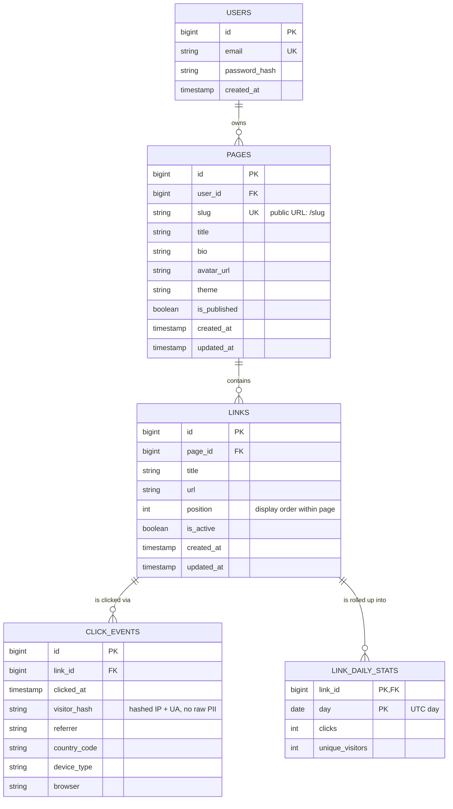

# Data model: link-in-bio with analytics

## Notes

- **Ownership chain:** `users → pages → links`. A user can have several pages. Each link belongs to exactly one page.
- **`click_events`** is the append-only raw log. It has one row per click and is never updated.
- **`link_daily_stats`** is a rollup of `click_events`. A scheduled job fills it in, grouping by `link_id` and UTC day. The composite primary key `(link_id, day)` makes the job idempotent, because you can re-run it with an upsert.
- **Dashboards** should read from `link_daily_stats`. Use `click_events` only for drill-downs and for rebuilding the rollups.
- **Page-level stats** need no table of their own. Sum the daily stats over `links.page_id`.
- **Suggested indexes:**
  - `click_events (link_id, clicked_at)`
  - `links (page_id, position)`
  - `pages (slug)`, which is already covered by the unique key
- **Retention:** you can partition or purge old `click_events` once they've been rolled up. Keep `link_daily_stats` indefinitely.
- **Deleting links:** if you want stats to survive link deletion, soft-delete links with `is_active` or an added `deleted_at`. Otherwise cascade the delete to `click_events` and `link_daily_stats`.
