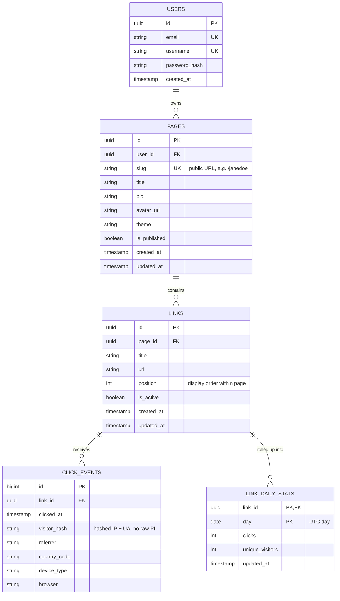

# Data model: link-in-bio with analytics

## Notes

- **Cardinality:** a user can have several pages, a page has many links, and a link has many click events and many daily stat rows (one per day).
- **`LINK_DAILY_STATS`** has a composite primary key `(link_id, day)`. It is derived data. A scheduled job aggregates `CLICK_EVENTS` into it, so dashboards don't scan raw events.
- **`CLICK_EVENTS`** is append-only and high-volume. Suggested index: `(link_id, clicked_at)`. Consider partitioning by month and pruning old rows once they've been rolled up.
- **Privacy:** store a hashed visitor identifier, not the raw IP. `unique_visitors` is a count of distinct `visitor_hash` values per link per day.
- **Ordering:** add a unique constraint on `(page_id, position)`, or reorder in the application.
- **Deleting links:** if links can be deleted, either soft-delete them (use `is_active`) or cascade to events and stats.
- **Not included:** page views. If you want click-through rate, add a `PAGE_VIEWS` event table and a matching daily stats table keyed by `page_id`.
