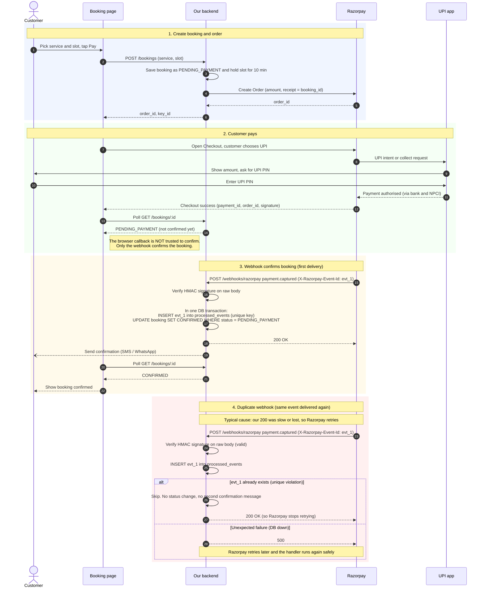

# Salon booking paid with UPI: sequence diagram

Covers the happy path and a duplicate `payment.captured` webhook. Mermaid renders it on GitHub, in VS Code (with a Mermaid extension) and at mermaid.live.

## Why the duplicate is harmless

- **Dedupe key:** the `X-Razorpay-Event-Id` header is stored in `processed_events` with a unique constraint. The database enforces "once only", even if two copies arrive at the same moment on different servers.
- **Same transaction as the state change:** the dedupe row and the booking update commit or roll back together. A crash cannot leave the event marked processed with the booking unconfirmed.
- **Guarded update:** `WHERE status = PENDING_PAYMENT` makes the booking update idempotent even if the dedupe table is bypassed.
- **Always return 200 for a known duplicate:** a 4xx or 5xx would make Razorpay keep retrying.
- **Side effects run once:** the confirmation message is sent only when the transaction actually changed the booking, not on a duplicate.

## Assumptions to check against your system

- The slot hold is 10 minutes. Use your real value. If the webhook arrives after the hold expires, you need a refund or re-book path. That path is not shown here.
- The page polls for status. You could use a websocket or server-sent events instead.
- Razorpay talks to the UPI app through the bank and NPCI. This is collapsed into one arrow.
- The confirmation message is sent inline after the commit. A queue or outbox would be more robust.
